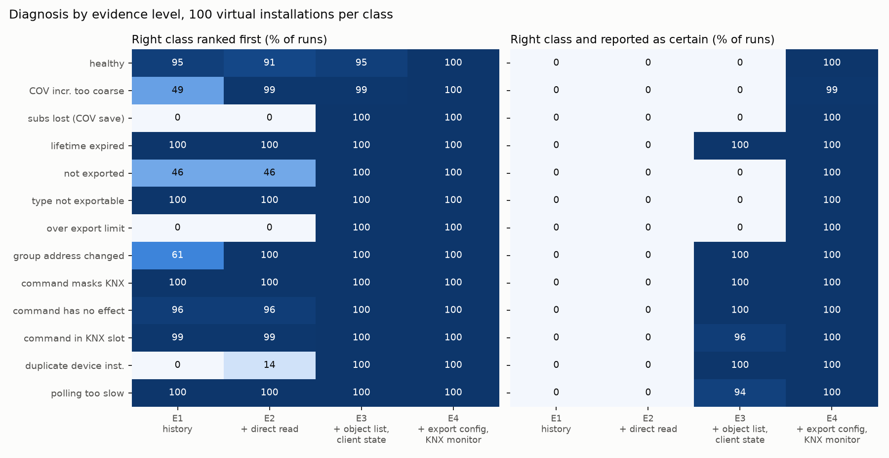

# knx-bacnet-gateway-stale-values

Why values from a KNX installation go stale, missing or move on a building management
system that reads them through a KNX controller's BACnet/IP server, and what a
change-of-value setting costs.

## In plain words

- A building computer reads room values from KNX through a small gateway that speaks BACnet.
- When a value looks old or is missing, twelve different mistakes can be the cause.
- Looking only at the value history, the right cause comes first in about 65 % of cases.
- Two cheap extra checks, the gateway's object list and the client's settings, raise that to 99.5 %.
- The default "report when it changes by 1" hides almost every change of a room temperature.
- A command from the building computer can hide later KNX changes, do nothing at all, or
  bring back an old value. Which one depends on where the gateway puts KNX values in the
  BACnet priority array.

**Simulated study, no hardware.** No recording from a real installation was used. The server
and client are modelled at object and service level from the sources in
[docs/SOURCES.md](docs/SOURCES.md); messages are counted, not encoded. **No conformance to the
BACnet standard (ANSI/ASHRAE 135) is claimed.** Every number below comes from
`results/summary.json`, written by `scripts/run_all.py`, and a script checks that.

## The question

A building management system reads the values of a KNX installation through the BACnet/IP
server of a KNX logic controller. Some values on the building system are stale, missing or
have moved. Which causes can be told apart with certainty, from which evidence, and what
does a change-of-value (COV) setting cost in missed changes against network traffic?

## The answer

Tested on 1300 randomised virtual installations (100 per class: 12 injected faults and
healthy), each watched for 4 h. The diagnosis engine sees one of four evidence levels:
E1 the value history on the building system, E2 plus one direct ReadProperty of the
complaint point, E3 plus the device's object list and the client's subscription or polling
state, E4 plus the gateway's export configuration and a KNX group monitor recording.

1. **The value history alone proves nothing, and two faults are identical in it.** At E1 the
   right class is ranked first in 65 % of the runs on average and no verdict is certain.
   Subscriptions lost because someone saved the gateway's COV settings and subscriptions
   that expired because the client never renews look the same in 100 % of the runs: every
   point stops at one moment. A duplicate device instance looks healthy in 68 % of the
   runs, a too-coarse COV increment in 51 %.

2. **One extra piece of evidence separates each pair, and it is cheap.** The direct read
   splits "stale" from "missing": a stale value reads back right, a missing object answers
   OBJECT / UNKNOWN_OBJECT. The object list shows a moved object under a new instance with
   its old name (group address changed: certain in 100 % at E3). One Who-Is that gets two
   I-Am answers proves a duplicate device (100 %). The client's own record proves an expired
   lifetime (100 %). The Priority_Array, read against the BMS's own command log, proves each
   of the three command faults of finding 6. With E3 the right class is first in 99.5 % of
   the runs.

3. **Five faults need the gateway's configuration and a KNX monitor to be certain.** A
   missing export flag, a date or text object, an object above the 150-object limit, a
   too-coarse increment and subscriptions cancelled by a settings save are certain only at
   E4. Over all levels the engine gave 1989 "certain" verdicts and 0 were wrong. With a 1 h
   or an 8 h window it also made no wrong certain verdict.

4. **The default increment of 1 is wrong in both directions.** On a room temperature that a
   sensor sends in 0.1 K steps, an increment of 1 hides 96 % of the changes; the value
   shown can be 0.99 K off and stay wrong for 23.48 h. On a power value in watts the same
   1 means every meter telegram is sent. Setting temperatures to 0.1 K and power to 10 W
   costs 6.28 instead of 4.39 notifications per object per hour, which is 3.49 messages per
   second for 2000 objects (6.98 confirmed). Polling the same 2000 objects every 60 s with
   one ReadProperty each costs 66.7 messages per second. **Rule for commissioning: set the
   COV increment to the step the KNX sensor sends on (here 0.1 K and 10 W), never leave the
   default, and keep notifications unconfirmed unless the client needs the acknowledge.**

5. **Polling only beats a coarse increment, and saving COV settings hurts until the next
   renewal.** Against COV with 0.2 K (67 % of temperature changes never shown, p99 error
   0.19 K), polling misses more changes only from 3600 s, but its p99 error is larger from
   600 s. A switch polled every 60 s still loses 4 % of its changes; COV loses none. After a
   save of the COV settings the values stay stale until the client renews: 2.0 min on
   average (longest 4.8 min) with a 300 s renewal, 12.8 min (29.7 min) with 1800 s, and for
   good with lifetime 0 and no renewal. The save also deletes every BMS command, and the
   command stays lost until the BMS writes it again; the BMS still believes it holds for
   3.1 min, 16.6 min and 210.1 min on average. **Renew every 300 to 900 s**: for 150 objects
   that costs 1.0 or 0.333 messages per second. The guide says the save "resets the priority
   array values of all objects". If that includes the slot the gateway writes KNX values to,
   every object shows the value of its first read until its next KNX telegram: right after
   the save 74 % of the objects are wrong on the gateway itself, for 23.8 min on average and
   81.9 min for a setpoint. A commanded setpoint shows its commissioning value for 47.2 min
   on average while KNX still runs the command, and with a 300 s renewal that frozen value
   is what the BMS gets at its first renewal in 100 % of the runs.

6. **Where the gateway writes KNX values decides what a BMS command does.** The controller
   writes KNX values into one configurable slot of the priority array, and sets
   Relinquish_Default once, at the first read, never again (user guide). With the standard
   rule that the lowest-numbered non-empty slot wins, there are three different faults. A
   command above the gateway's slot masks every later KNX change until it is relinquished.
   A command below it is acknowledged and never becomes the value. A command in the same slot
   is overwritten by the next KNX telegram, and its relinquish empties the slot, so the
   value falls back to the frozen first value. In the value history they look different (the
   command stays, never appears, or the point returns to its first value): ranked first at E1
   in 100 %, 96 % and 99 % of the runs. The Priority_Array against the BMS command log makes
   them certain at E3 in 100 %, 100 % and 96 %. **Rule for commissioning: read the gateway's
   object priority and command from a slot with a lower number, never the same one.**



Left: share of runs with the right class ranked first. Right: right and reported as
certain.

Other figures:

- [results/confusion_matrices.png](results/confusion_matrices.png): injected fault against
  first-ranked class at E1 and E2; shows which faults look alike.
- [results/cov_tradeoff.png](results/cov_tradeoff.png): missed changes and notification
  rate against the COV increment for temperature and power, and the traffic of 150, 500
  and 2000 objects.
- [results/polling_and_save.png](results/polling_and_save.png): missed changes against the
  polling interval, and how long values stay stale after a COV settings save, by renewal
  interval.

All tables are in [results/tables.md](results/tables.md). A worked support case, written as
it would go back to the customer, is in [docs/SUPPORT_CASE.md](docs/SUPPORT_CASE.md). The
engineering dossier (requirements, trade study, validation, FMEA) is [DOSSIER.md](DOSSIER.md).

## How to run

```
python -m venv .venv && .venv/Scripts/python -m pip install -r requirements.txt   # Linux: .venv/bin/python
.venv/Scripts/python -m pytest -q                                                  # all tests
.venv/Scripts/python scripts/run_all.py                                            # regenerates results/ (2 to 4 minutes)
```

`scripts/check_readme_numbers.py` fails if a number in this file is not in `summary.json`;
the test suite and CI run it.

## What is modelled

- KNX side: group objects with 3-level group addresses and datapoint types `1.001`, `5.001`,
  `9.001`, `13.010`, `14.056`, `10.001`, `11.001`, `16.000`. Value behaviour: room temperature as a
  slow random process sent on 0.1 K change, setpoints in 0.5 K steps, switches, blinds,
  power sent on 10 W change, an energy counter.
- Gateway BACnet server: export flag; binary to Binary Value, numeric to Analog Value,
  other types not exported; instance number = group address as a 16-bit number
  (1/1/1 is 2305, from factors 2048, 256 and 1); export limit 150 for the small variant;
  commandable Present_Value with 16 priority levels; KNX values written into one
  configurable slot; Relinquish_Default set at the first read and frozen; per-object COV
  increment, default 1; subscriptions with lifetime, renewal and an immediate notification;
  at most 256 subscriptions; saving the COV settings cancels all subscriptions and resets
  all priority arrays.
- Services as a client sees them: Who-Is / I-Am, ReadProperty, ReadPropertyMultiple of the
  object list, SubscribeCOV, confirmed and unconfirmed COV notifications, WriteProperty with
  priority, and the error class and code for an unknown object or property.
- Client: binds the device by the last I-Am it heard, then polls every point or subscribes
  and renews (or never renews); keeps a value history, a fault flag per point and a command
  log.
- Twelve faults: COV increment too coarse, subscriptions lost by a settings save, lifetime
  expired, export flag missing, type not exportable, over the export limit, group address
  changed, a BMS command that masks KNX, one that has no effect, one written into the
  gateway's own KNX slot, duplicate device instance, polling too slow.

## What is not modelled

- The byte encoding of BACnet messages, segmentation, network loss and delay, timeouts and
  retries. A message is a count.
- Foreign-device registration with a BBMD, which the gateway offers with a lease time. If
  the registration lapsed, for example because the BBMD restarted, the gateway's broadcasts
  such as its I-Am would not reach the building system's network until the next
  registration.
- The "Overwritten flag" of the user guide (its meaning is unclear; open point O1 in the dossier).
- KNX bus timing (see the sibling project on TP1), KNX telegrams lost on the bus.
- Several faults at once, other BACnet clients writing to the gateway, a gateway restart
  (it would look like a COV settings save).
- Change of Status_Flags, SubscribeCOVProperty with its own increment, COV on objects
  other than Analog Value and Binary Value.

## Limits and what I would do next with real hardware

- The export rules, the 150-object limit, the default increment of 1, the save behaviour
  and the priority behaviour come from the controller's public user guide, quoted in
  docs/SOURCES.md. The first version of this study modelled a KNX telegram as writing
  Relinquish_Default. That was an assumption, the guide contradicts it, and it is
  corrected.
- Still assumed: the default slot for KNX values (A4), whether the reset at a save also
  empties that slot (A5), what a BACnet write does on KNX (A16), how the instance number is
  formed (A15), which objects drop out above the limit (A2). The bench tests that would
  settle each one are in [docs/BENCH_TEST_PLAN.md](docs/BENCH_TEST_PLAN.md).
- The guide explains the increment as "changes by more than 1"; the model reports at a
  change of at least the increment. With the increment equal to the sensor step, the
  stricter reading would report only 56 % of temperature changes (table T12). Open until
  tested on a controller.
- The signal statistics are assumptions. The COV-against-polling result moves with them:
  with half the temperature movement polling never misses more than COV with 0.2 K; with
  twice the movement it does from 900 s (table T10).
- The engine is checked against the same simulator that made the faults. Its certainty
  rules rest on premises (DOSSIER section 4) that a real installation can break.
- The model check of the COV rule against the random-walk formula is within 3.1 % at
  0.1 K but 13.2 % off at 0.4 K, where few events are counted (table T9).
- Next with hardware: run the bench test plan, then create each fault on purpose on a test
  board, record the client's history, the Who-Is answers, the object list and a group
  monitor, and run this engine on them.

## Repo map

```
bacgw/knx.py          group addresses, instance mapping, datapoint types, value behaviour
bacgw/server.py       gateway BACnet server: export, objects, priority array, COV, services
bacgw/client.py       building management system: binding, polling, subscriptions, logs
bacgw/sim.py          virtual installation, fault injection, evidence at the complaint
bacgw/diagnose.py     diagnosis engine: rules per evidence level, certainty, report text
bacgw/evaluate.py     confusion matrices over randomised installations
bacgw/covstudy.py     COV increment, polling and COV-settings-save studies, model check
scripts/run_all.py    one command that regenerates results/
scripts/check_readme_numbers.py   fails if a README number is not in summary.json
tests/                pytest tests
results/              summary.json, tables.md, four figures, support-case evidence
DOSSIER.md            systems-engineering dossier
docs/SOURCES.md       every source with what was taken from it, and what could not be verified
docs/SUPPORT_CASE.md  worked support case
```
